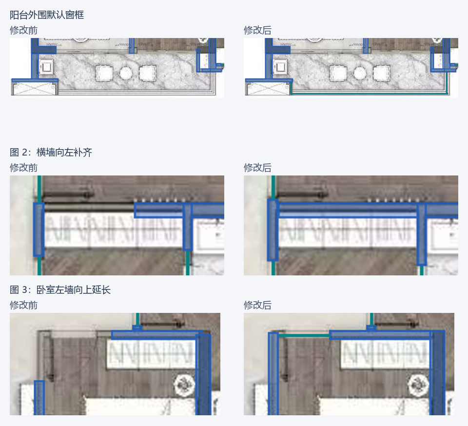

# 阳台外围窗框与墙段断尾核查

日期：2026-10-10。来源：用户反馈的三处示例户型截图，对应 `input/floorplan.png`。

## 结果

- 图 1：左下阳台底边、右侧和左侧短转角输出三段外围玻璃窗候选，支持相接窗框封边；洞口扣除并沿用三维窗框/玻璃。不是实墙补闭合，也未自动标定或设置落地窗高度。
- 图 2：柜子上方横墙原左端 x=447，恢复至 x=369，与左侧竖墙外框相交。原厚度保留。
- 图 3：卧室左墙原上端 y=515，恢复至 y=467，下端 y=659 保留；底图转角约 y=465，存在约 2 px 的图像阴影/端点估计偏差。
- 本次同时恢复了卧室上方的平开门候选。粗墙仍为 26 段，洞口从 10 增至 14：三段外围窗框与一处门。

`before.json` / `before.png` 是修改规则前保存的识别结果；`after.json` / `after.png` 是修改规则后重新运行墙、门窗与实墙整理管线的结果，不含人工补墙。浏览器截图 `browser.png` 包含家具的完整识别结果。

## 规则与边界

墙段恢复从已有实墙出发，逐像素检查灰度截面、暗像素比例与边缘对比，限制延伸距离，遇到空白即停。外围窗框用成对线条及图外白区证据，要求两端通过窗框转角网络或可观察结构门垛获得支撑；缩放时可能被粗墙误提取的短窗框仍需转角链证明。孤立矩形、无支撑纹理线和实心外围不得自行成为玻璃。

算法版本更新为 `filled-outlined-and-multicolor-walls-v5`、`wall-aware-frames-and-pale-swing-arcs-v5`。没有绑定文件名、墙编号、图片哈希或示例坐标；测试坐标仅用于选定点回归。

这是图像规则改进，尚非完整户型语义识别：不自动命名阳台，不承诺所有分辨率、所有窗型都完整，也无法单凭线条证明玻璃与栏杆材质。原项目不会自动覆盖；新识别结果可另存，旧页和未保存编辑需保留。

## 验证

- `python -m unittest discover -q`：120 项通过（276.515 秒）。
- `node --test test_model_geometry.mjs`：9 项通过。
- 对另存项目做实际三维数据核查：O012 / O013 / O014 均生成玻璃网格，未出现门窗脱离宿主的警告。`model-check.json` 使用仅供测试的 10 mm/px 比例，未给用户项目写入比例。
- 新增原图、镜像、90° 旋转和约 1.5 倍放大核查：两处实墙选定点被覆盖，三处窗框选定点保留为空洞，重复实墙整理结果一致。
- 合成图核查：色差墙延伸到门洞边即停止；宽家具/地面填色不延伸；孤立多线矩形不变为窗；实心 U 形外围不变为窗。
- 浏览器先重新识别示例，再核对三段外围窗候选与两处墙段；再次识别核对结果，保存并重新打开项目。

浏览器第二次识别使用未编辑的识别缓存，墙体和门窗数组与首次完全一致；独立 Python 原图回归另行运行识别算法。另存项目为 `20261010-182626-464b5f`，恢复后保留 14 处洞口与 24 件原始识别家具。本次新结果未迁移其他项目里的家具人工编辑或标定；旧项目及原页面继续保留。

新版预览服务运行在 `http://127.0.0.1:8775/`；原 8774 服务保留以保护原编辑会话。
