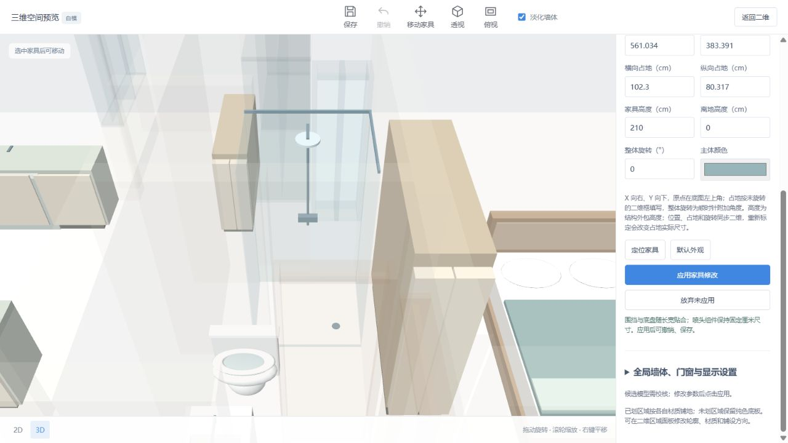
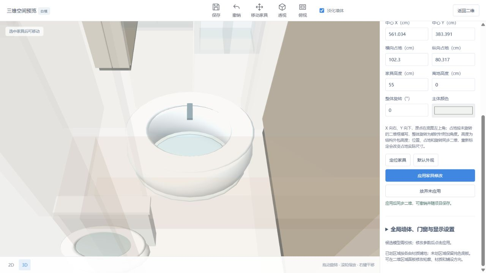

# 洗浴区建模核查

2026-10-10：取消洗浴区必须确认才生成模型的限制。已有 `wet_area` 直接渲染默认淋浴，排除状态仍不渲染；类别菜单提供独立淋浴、浴缸类型。

淋浴底盘与玻璃围挡按矩形占地贴合，花洒硬件采用实际尺寸。顶喷直径 20 cm，立杆直径 2 cm、长度 110 cm；横臂、喷头面板和宽 18 cm 控制件保持尺寸。改变长宽、重新标定和整体旋转不会把圆喷头拉成椭圆。高度调整移动安装位置；围挡过低时喷头可高于围挡，硬件保持尺寸，未增加任意花洒资源或编辑预设的入口。

浴缸使用独立椭圆盆体与浴缸口、内盆、龙头，不生成淋浴围挡或顶喷。浴缸／淋浴切换时恢复 55 cm／210 cm 默认高度，显式提供高度优先，位置、占地、离地和整体旋转保留。

## 当前方案

先保存用户当前重新识别结果为 `20261010-205331-22806f`；新版副本为 `20261010-205712-523187`，将 F008、F016 直接作为洗浴区生成默认淋浴。墙体、门窗及其他家具逐项保持一致。重新识别后的比例为空，确认图片哈希与此前已标定方案相同后，恢复其标定端点、实际长度及比例 17.001802950982565 mm/px。旧页面和原保存版本保留。

浏览器完成浴缸切换、55 cm 高度及独立盆体核查后，撤销该临时切换，两个洗浴区恢复默认淋浴；最终保存为 `20261010-211536-46072c`。页面保留三维 F008 淋浴细节。

## 验证

- 18 项 Python：家具类别编辑、类型切换高度、显式覆盖、输入原子性、保存重开、撤销与实际示例识别。
- 28 项 Node：家具结构、旧洗浴区直接渲染、淋浴和浴缸不同组件、固定硬件实际尺寸、非等比占地变化、比例变化、整体旋转、移动和门窗几何回归。
- 浏览器三维模型数量由 22 件增为 24 件，F008、F016 均可选中与定位，无需类型确认。

## 限制

现有洗浴区使用默认淋浴类型，不声称自动区分无明确图例的浴缸和淋浴。模型为程序化示意，未提供写实商品模型、玻璃门开合、排水坡度、给排水管线或单独选择围挡侧面。
