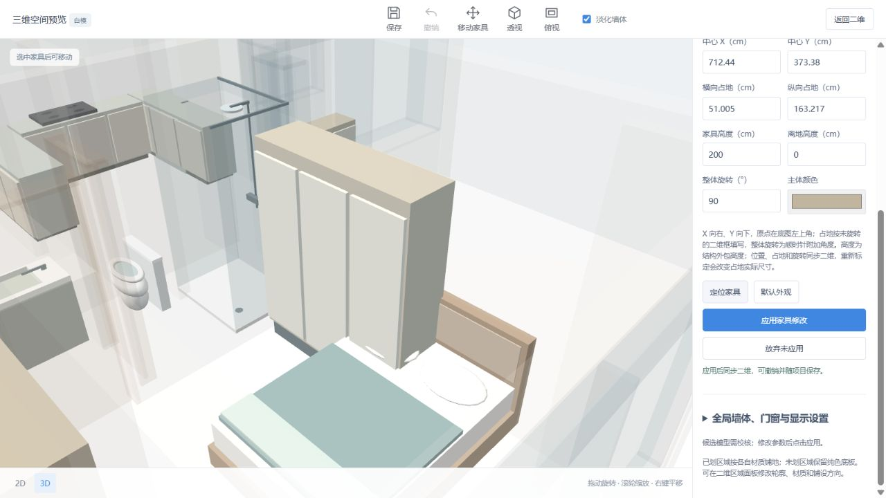

# 柜门默认长边核查

2026-10-10。用户指出竖向长柜的柜门出现在窄端，长侧面为空白。

普通柜、鞋柜、电视柜与厨房柜台改为按当前矩形占地的长边布置柜门及把手。柜体主体、底座和正面留位一起适配，门扇数量按长边长度计算。正方形沿用原正面；冰箱仍使用原来的分层门模型。

只转换模型部件的局部坐标，不修改已保存的对象位置、二维占地、整体旋转、高度、离地、颜色或类别。改变占地长宽后会重新判断长边；未增加逐面柜门选择或开启动画。

验证：`node --test test_furniture_models.mjs test_furniture_move.mjs test_model_geometry.mjs`，26 项通过。检查四类柜体横放、竖放、正方形的门扇与把手位置，输入不变，已有整体旋转、比例变化、淋浴固定硬件与移动边界回归通过。

先保存用户页面当前编辑为 `20261010-213515-870b3a`，再加载新版模型；不用重新识别。核查 F007 柜子的门板位于长侧面。

