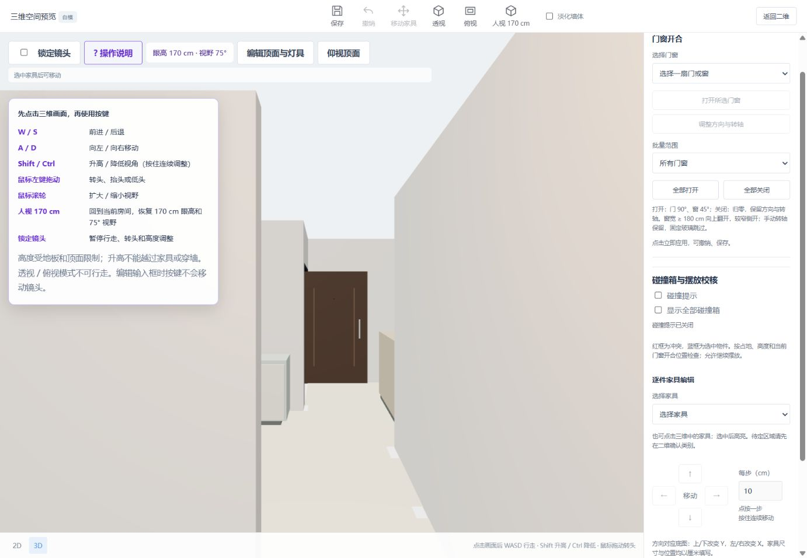
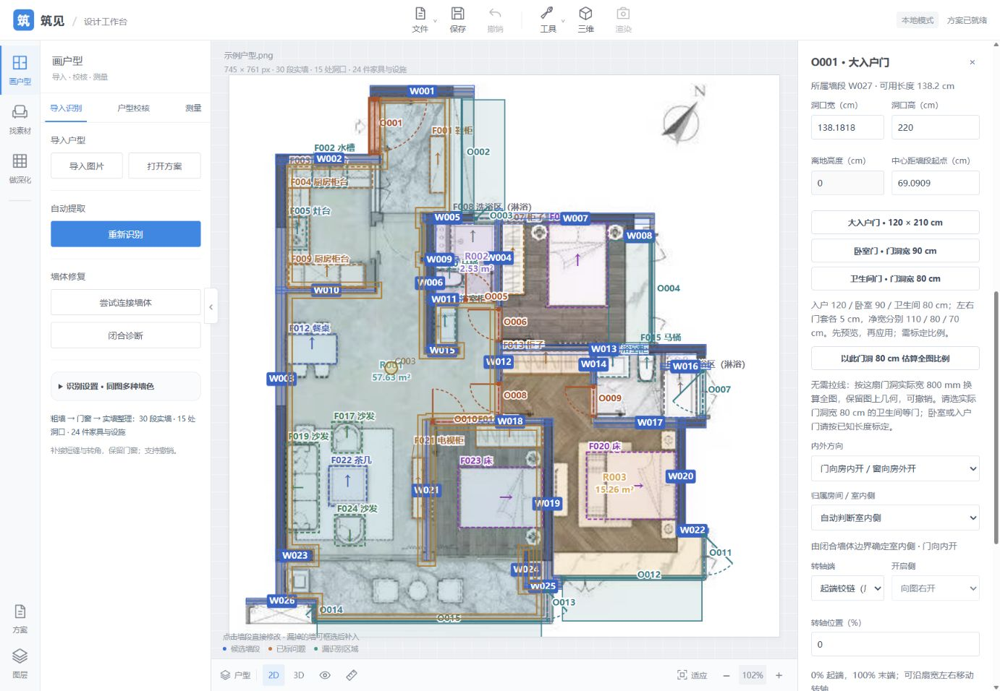

# 人视高度、75° 视野与操作说明

2026-10-14，在稳定人视控制上增加：Shift 升高、Ctrl 降低；人视默认垂直视野由 65° 扩大到 75°，单灯查看由 55° 扩大到 65°。Shift 不再加速水平行走。左上角新增紫色“? 操作说明”，点击展开完整按键说明；旁边实时显示眼高和视野，底部保留主要按键提示。

点击画面后 WASD 行走，Shift/Ctrl 按住连续调整眼高，每秒 60 cm；两者同时按下抵消。鼠标拖动仍只转头，滚轮仍只调整视野。高度调整保持朝向，并与水平行走共用碰撞约束、4 cm 小步防穿越和停止条件。“人视 170 cm”恢复当前房间有效站位、170 cm 眼高与 75° 视野。

眼高限制在 40～300 cm，头顶按眼高加 15 cm 校核。实际顶面可能进一步限制升高；降低不会到地板下面。人体始终从地板到头顶校核，所以升高镜头不能飞越家具或窗台。仍采用已有构件占地近似和平层底板。

画面聚焦且处于人视时，Ctrl+WASD 优先作为移动输入，阻止同次按键触发页面保存等快捷键；输入框内保留编辑快捷键。锁定镜头、失焦、松键及关闭三维会停止移动。

当前方案 O001 大入户门原高 210 cm，通过已有单件属性编辑加高至 220 cm，保留当前宽度、开启方向和角度。保存为本地项目 `20261014-201840-d3b626`，重新打开核对。其他门和新增门预设没有随此单件修改改变。

## 验证

- 130 项全量 Node 测试通过；相机与行走测试共 12 项，新增覆盖 Shift/Ctrl 高度及快捷键隔离、地板/顶面限制与不能飞越家具。
- 浏览器核对人视 170 cm / 75°、升高/降低后的实时状态、问号说明展开/关闭、回到默认人视、门高 220 cm 保存重开。

