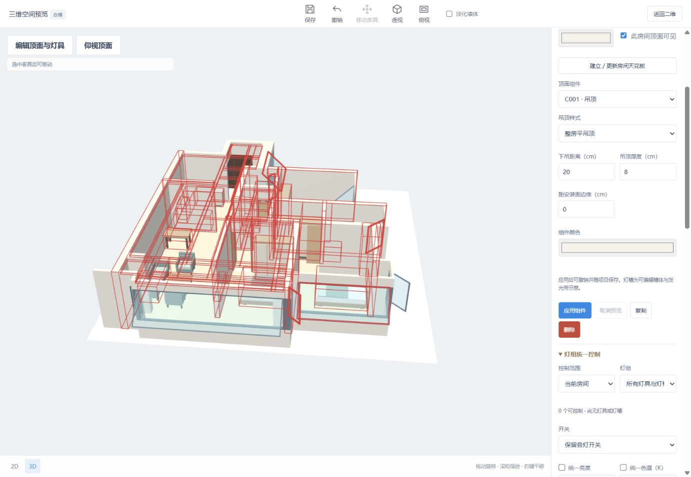

# 顶面编辑前置条件与直接分区入口

2026-10-14 修复当前已标定但未分区方案中，三维有默认补顶、顶面设置全部禁用且没有直接操作入口的问题。

- 未识别/未打开方案、未标定、未分区及另有未应用修改分别给出原因。
- 二维/三维顶面编辑器提供“建立房间分区，启用顶面编辑”；沿用现有分区接口及一次撤销。
- 未标定提供“前往比例标定”，从三维返回二维测量面板。
- 已排除房间不进入顶面选择；三维摘要分别显示可编辑房间顶面与临时默认预览顶面。

实际页面核查：当前方案比例已标定、房间分区为零，三维原先有 4 个默认预览顶面。新入口建立 3 个房间后，所属房间、标高与顶面组件选择启用；撤销恢复未分区提示与禁用状态，再次建立分区、保存重开后设置仍可用。三维摘要显示 3 个房间顶面与 2 个默认预览顶面。分区前后保存数据的底图、墙体、门窗、家具与比例一致。7 项顶面 Node 几何回归及 JavaScript 语法检查通过。

