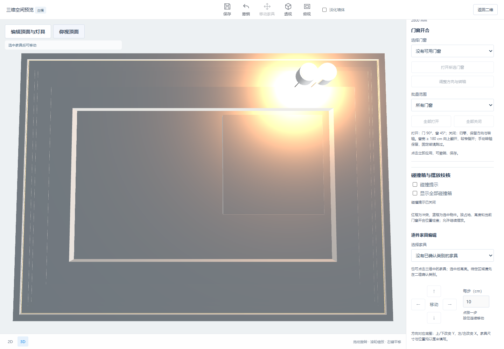
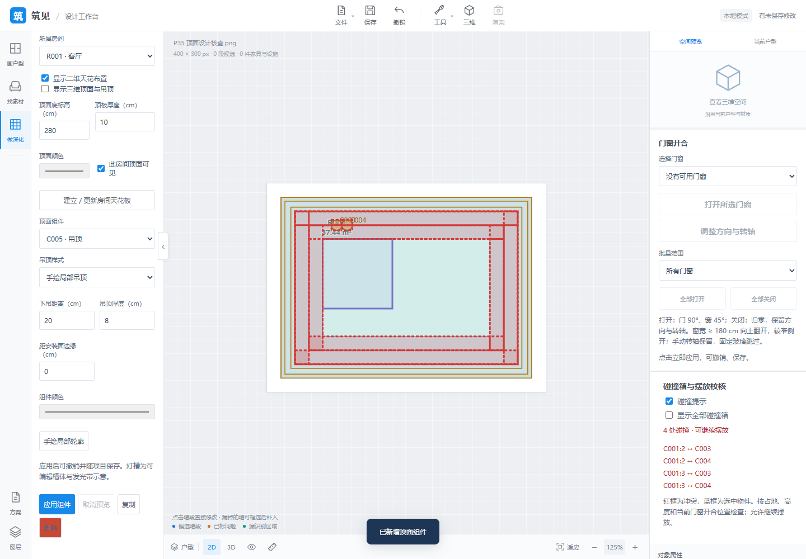
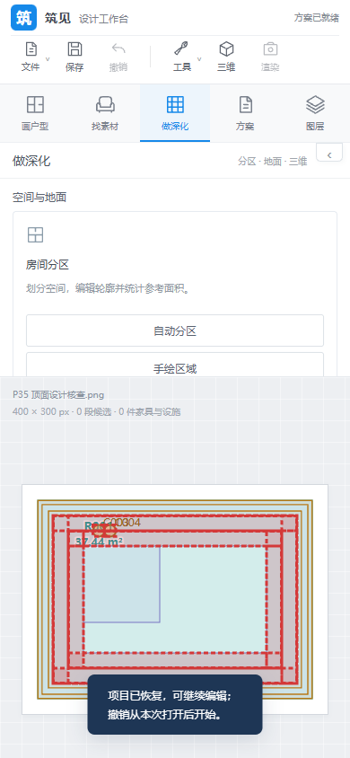

# P35 天花板、复杂吊顶、灯槽与灯具

2026-10-13 已接入工作台；进入 **做深化 → 天花板 · 吊顶 · 灯具**。先标定实际比例并校核房间轮廓。

2026-10-14 补齐前置条件入口：未分区时点击“建立房间分区，启用顶面编辑”，可直接在二维或三维生成可编辑房间；未标定时提供标定入口。有其他未应用修改时先应用或取消。三维自动补出的默认预览顶面不自动成为可编辑房间，摘要分别显示两种数量；已排除房间不进入编辑列表。已在当前未分区方案验证三维直接分区、设置启用、分区撤销恢复提示及保存重开。

- 房间独立顶面支持凹形、孔洞与多块区域，可修改底标高、厚度、颜色与单房间可见性。
- 吊顶支持整房平顶、手绘局部、边吊、1～5 级跌级，修改下吊、厚度、距边、每级宽度和级差；跌级包含立面封板。局部轮廓不能穿越墙体或房间孔洞。
- 灯槽沿所选顶面/吊顶安装面的边界生成，具有底板、内外挡边、发光带；宽高、边距、颜色、开关、亮度和色温可编辑。
- 六类示意灯具：吸顶灯、筒灯、吊灯、射灯、轨道灯、线性灯。可编辑位置、尺寸、下挂、旋转、颜色、开关、亮度、色温和射灯方向。二维定位与复制接入。
- 灯具/灯槽绑定房间顶面或某一级吊顶底面，调整标高时跟随；依附组件未处理时不能删除安装面。无效编辑不写入项目。
- 二维布置与三维共用编辑器；顶面默认隐藏，可显示或点击 **仰视顶面**。预览、取消、Esc、共享撤销、保存重开同步。
- 碰撞包含吊顶、槽体、灯具与家具/门窗；顶面三角形保留孔洞，不用整房矩形封住孔洞。同组件封板及正常安装接触跳过，独立吊顶相互穿透仍提示。
- 手工重画/合并房间保留顶面归属；重新分区或切分导致歧义时保留原数据并提示，可选择失效组件将整组恢复到指定房间。

长度输入使用 cm。所有默认尺寸都是可修改的示意预设；本版不判断建筑或照明规范。实时照明最多启用 16 个灯具光源；灯槽为槽体与发光带示意，尚不模拟真实间接反射。真实材质、商品模型、弧形/自由剖面、独立轨道系统、精细阴影和效果图仍待扩展。2026-10-14 已接入[灯具与灯槽分组控制](../lighting-groups-v1/README.md)。

## 验证

一次全量 Python 回归 192 项通过；随后顶面、房间编辑、保存与页面接口专项 35 项通过。Node 全量 114 项通过，包含 5 项顶面几何/碰撞检查。桌面与 390 px 窄屏实际浏览器检查覆盖预览/取消、跌级、灯槽、六类灯具三维预览、复制、局部手绘、仰视、编辑撤销及保存重开；原有碰撞交互浏览器回归通过。

```powershell
.\.venv\Scripts\python.exe -m unittest test_ceilings test_room_editing test_projects test_web
node --test test_*.mjs
# 在 NODE_PATH 提供 Playwright 后运行：
node tools/check_ceilings_ui.cjs
```






