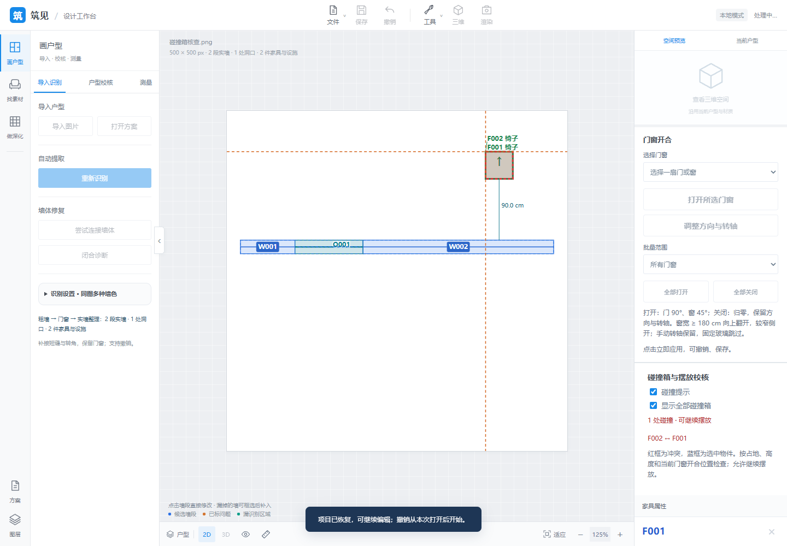
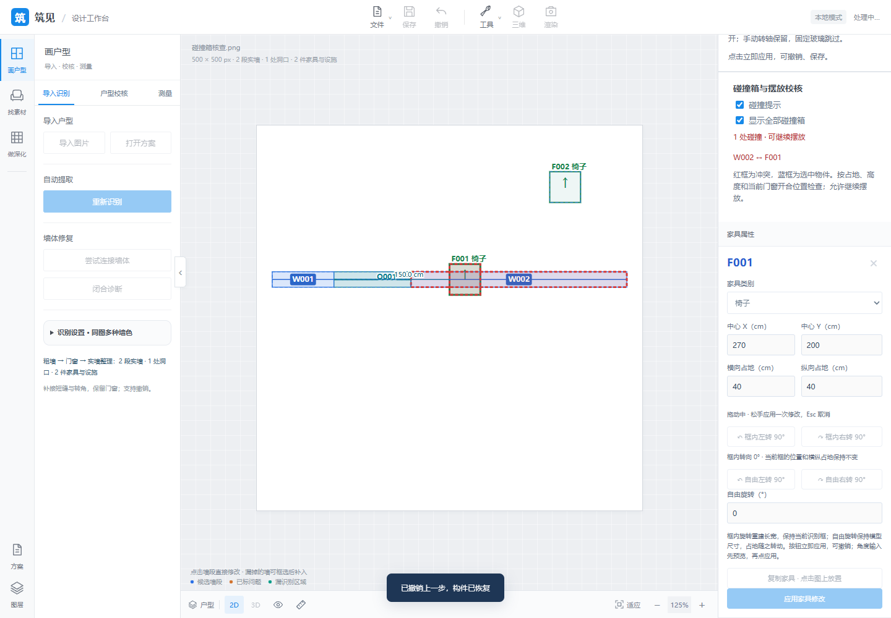
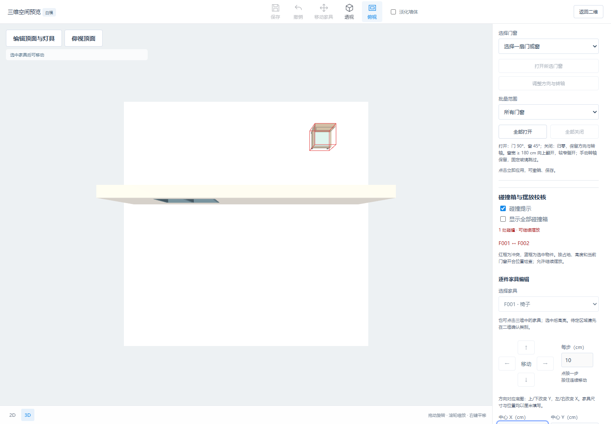
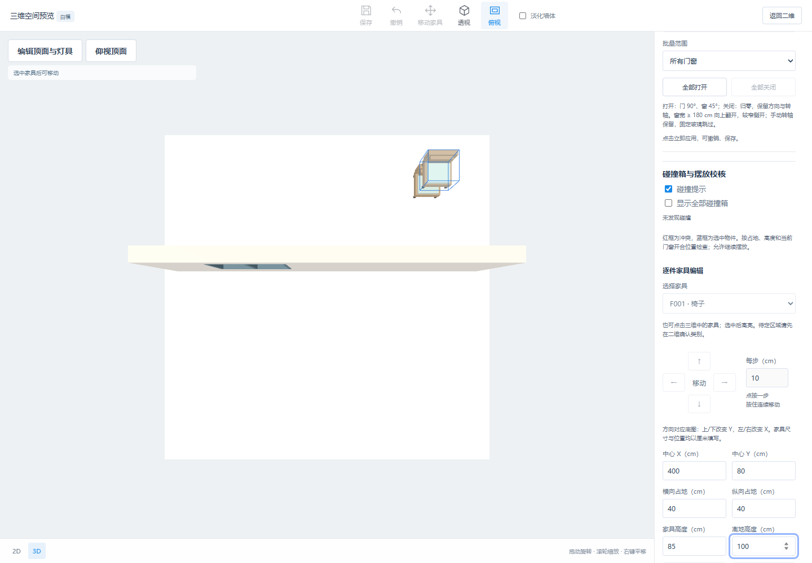
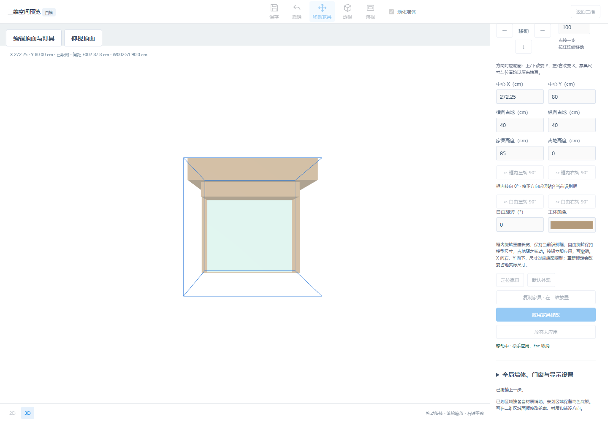

# 碰撞箱与摆放校核首版

2026-10-13。二维/三维侧栏新增“碰撞箱与摆放校核”。默认开启碰撞提示，红框表示冲突，蓝框表示选中物件；可开启全部碰撞箱，或关闭提示。开关在二维和三维同步，仅为查看设置，不新增修改历史。

家具使用旋转后的占地、类别或自定义高度及离地距离建立有向包围盒。墙体直接沿用三维墙段与补角，保留门窗洞口、窗台及过梁；门扇、固定玻璃及活动窗扇按当前姿态参与检查，包括绕横轴翻开的窗扇。固定门窗框与同一对象内部组件不产生自碰撞提示。

移动、方向按钮、自由/框内旋转、复制、新增家具与数值修改均在预览时更新。取消和失败恢复原位，撤销后重算；保存重开基于恢复的几何重建，无需新增项目参数。未标定时提示先标定。检查不修改尺寸、洞口或房间数据，也不阻止继续摆放。

首版采用占地箱近似；桌椅下方空腔、细小外伸五金及喷头等部件不做精确网格碰撞。1 mm 以内的接触不报冲突。占地完整嵌入厨房柜台的水槽/灶台允许重叠，越出柜台仍提示。排除对象与未知区域不参与。当前只检查最终/预览姿态，不检查拖动或开合经过的整条路径，也不判断通道规范。

验证：全量 **109 项 Node** 通过，其中新增 **13 项碰撞几何测试**；Python 页面资源/请求保护测试通过。隔离临时项目的桌面与窄屏浏览器验证二维拖动、穿墙/重叠提示、复制、取消、继续摆放、撤销、三维数值修改与高度分离、方向按钮、三维指针拖动及 Esc、开关同步、保存重开；无页面脚本错误。测试不修改用户项目。

```powershell
node --test test_*.mjs
# NODE_PATH 设置为含 Playwright 的 node_modules 目录后：
node tools/check_collision_boxes_ui.cjs
```







天花板、吊顶和灯具仅补充至根目录 FEATURES.md 的 P35 待实现规划，本次未创建这些组件。
