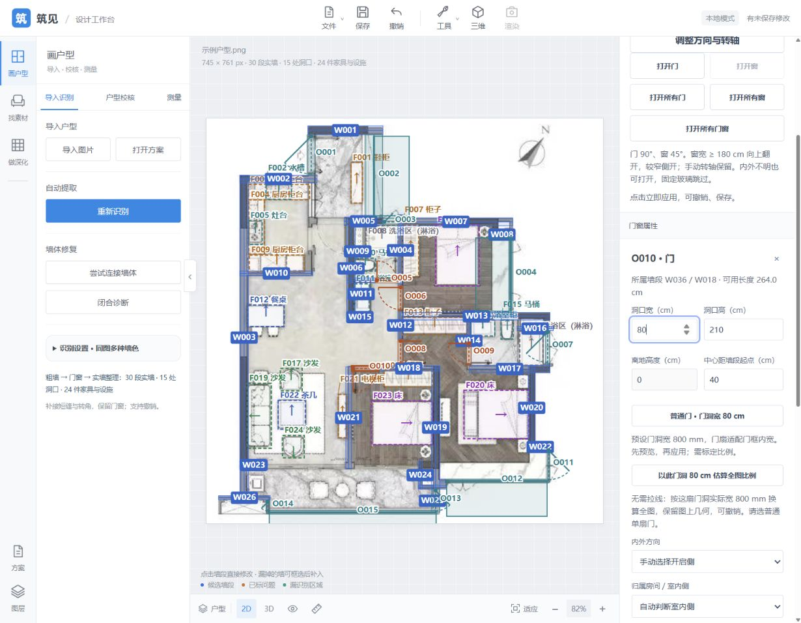
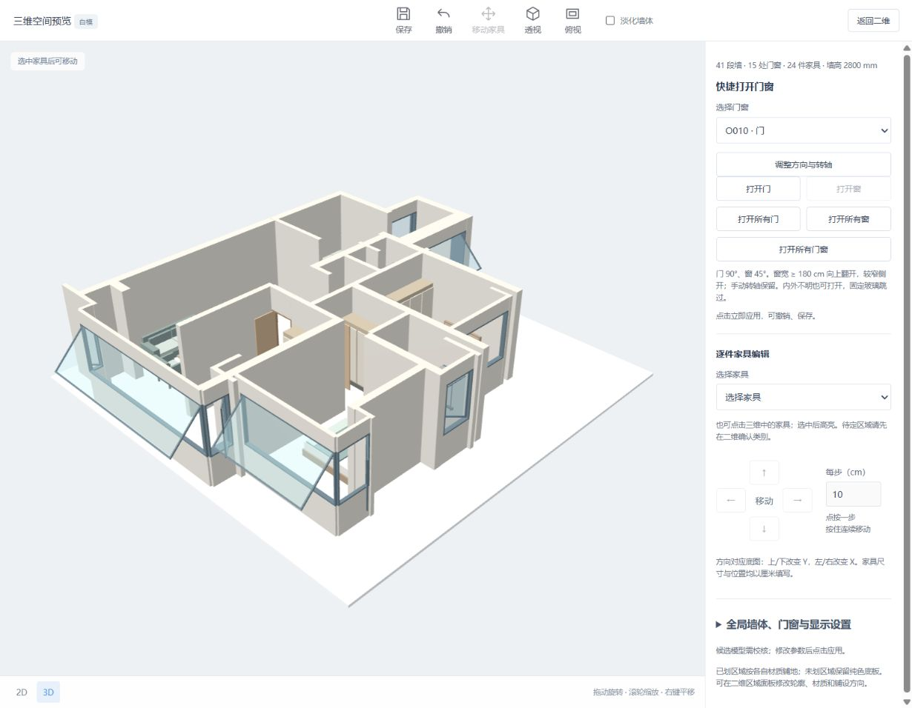

# 门洞 80 cm 比例尺 · 2026-10-12

按用户要求，普通门洞可以作为全图比例尺：800 mm ÷ 沿墙像素宽。原像素几何保留，尺寸来源切为按图換算，记录参考门和假定宽度；可撤销、保存重开或后续重新标定。

- 36 项相关 Python：横/竖门、未标定换算、图上几何保留、全局预设切换、门窗物理尺寸和窗宽开启模式重算、非法/过短/已排除/待确认参考拒绝、多种标定互斥、API 保存重开和一次撤销、后续拉线标定及原功能回归。
- 61 项 Node 原几何与窗宽预设回归通过；UI 脚本语法检查通过。
- 实际浏览器当前方案 20261012-180054-fee6f5：未标定时门洞比例尺可用，普通门宽度编辑暂禁用。选 O010 点击比例尺后，50 px 门洞按 800 mm 算出 16 mm/px，字段显示 80 cm，标定状态明确显示门洞估算来源；自动宽窗切换上翻，三维可直接查看。
- 当前结果保存为 20261012-183141-c0b695，原保存方案保留。门高与转轴未改。

