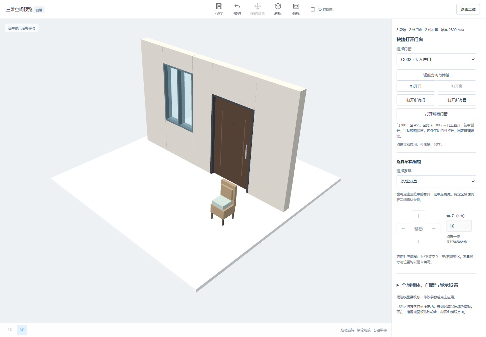

# 大入户门独立模型预设

2026-10-12。

原入户按钮只改洞口宽，复用普通门。现在新增持久化 `door_model: entry` 与独立程序模型，提供“新增大入户门”直接入口；已有门也可应用“大入户门 · 120 × 210 cm”。默认门洞宽 1200 mm、高 2100 mm，左右门套各 50 mm，净门扇宽 1100 mm。尺寸仍可改，普通卧室/卫生间预设可切回普通模型。

入户模型为单扇示意：深色 60 mm 门板、金属侧框、装饰条、长把手及猫眼。组件共享门扇转轴/旋转，改变角度、轴位和方向时一起更新。双开门、子母门及真实五金未实现。

内外判断优先使用与铺地无关的闭合结构区域，只有一侧闭合时取其为室内并向内开。缺少可靠分区时，只对处于整体墙体横/纵外轮廓的入户门作朝向户型内部的辅助判断，并提示校核；内部墙不套此规则。两侧均有闭合区域时提示“入户门通常一侧室外”，保留房间归属或手动选择，不强制覆盖。旧门不根据 1200 mm 宽度自动换模型，需显式选预设。

29 项相关 Python 测试和 68 项全量 Node 测试通过。浏览器验证直接新增入口、创建预览模型类型、已有门三预设、应用、保存重开、撤销、三维显示、家具/门窗回归及 390 px 窄屏，无页面错误；见 `browser-check.json`。

