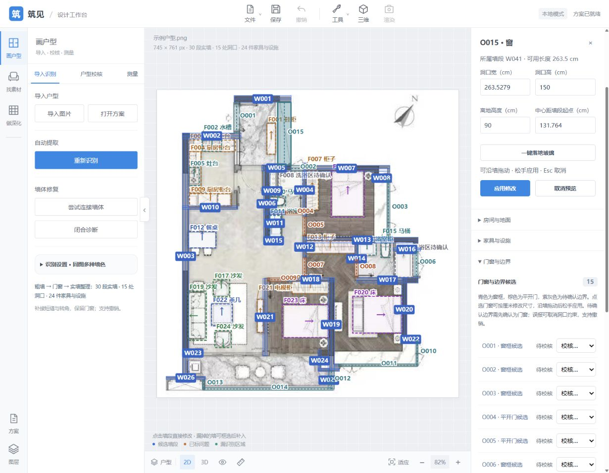
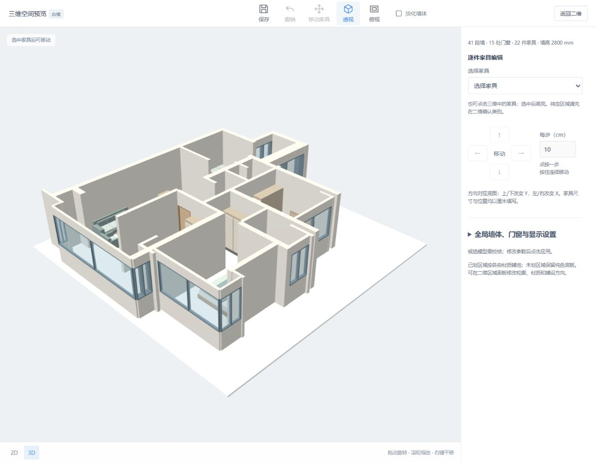

# 玄关鞋柜右侧玻璃核查

日期：2026-10-10。

用户指出鞋柜 F001 右侧、W001 右端向下还有玻璃。原窄窗框规则的配对间距上限为 14 像素（随图片比例缩放），漏掉约 31 像素宽的完整窗框带。

## 识别与方案

- 算法版本：`wall-aware-frames-and-pale-swing-arcs-v6`。
- 宽窗框带检查外围位置、至少三条平行线、内部非实心及两端结构支撑。另一端有结构支撑时，可用原图填充端帽恢复粗识别漏掉的端部；不整体放宽浅线阈值。
- 同一宽窗框内的窗扇不重复计数，邻近已有外围窗仍优先保留。
- 原图、水平镜像、90° 旋转及约 1.5 倍放大均覆盖新增玻璃所在点；合成图验证缺少第三条线或一端支撑时拒绝宽框候选。
- 示例原图识别输出 15 处门窗，新增窗连接 W001 与 W005。
- 从 `20261010-193830-b51a06` 另存补窗副本 `20261010-200747-a29262`，新窗为 O015，所属辅助墙为 W041。中心线 `(315,31)` 至 `(315,186)`，窗框带厚度 33 px。
- 旧方案 14 个门窗对象、家具和标定数据逐项保持一致。重复补窗得到 `added: []`。

新窗高度与窗台沿用全局默认值：150 cm、90 cm。它不是自动推断的落地窗；可在门窗属性中继续调整。

## 验证

`python -m unittest discover -q`：129 项通过，280.482 秒。

`node --test test_opening_edit.mjs test_model_geometry.mjs`：12 项通过。

实际补窗文档经 `buildModel` 核查：O015 使用 W041 连续墙段，生成一块玻璃，洞口跨度 `[31,186]`；无 O015 缺少所属墙或裁切警告。浏览器中选择 O015 后，厘米属性显示约 263.5 cm 洞口宽。

## 限制

适用于有清晰结构支撑的水平/垂直外围多线窗框，仍为待校核候选；未扩展斜窗、曲线窗、开启方式或写实窗框模型。补窗副本基于已保存版本，不迁移其他旧页面尚未保存的修改。
