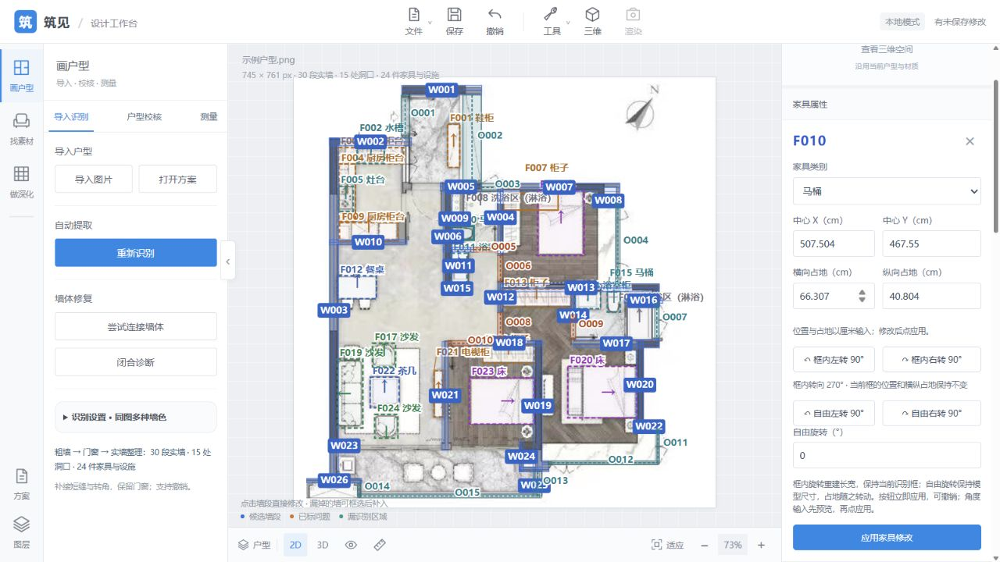
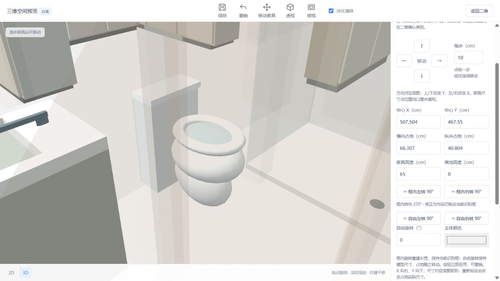

# 家具两种旋转核查

2026-10-10。保留自由旋转，新增二维、三维“框内左转／右转 90°”。

框内转向使用独立 `model_3d.fit_rotation_deg`，按照原朝向与框内转向交换局部长宽，再重建模型；附加自由角度继续使用 `rotation_deg`。框的中心、四个坐标与横纵实际尺寸不变；模型外观、离地和高度保留。正交自由角度可合并进框内转向，适配后自由角度归零。非直角自由角度会提示先调整，不自动取整。参照当前校核框，不恢复此前人工移动或修改的旧框。

淋浴喷头、立杆和控制件仍使用固定实际尺寸；外围随框重建。修正顶边框的 5 mm 外伸，使框内旋转时边框也处于矩形范围内；硬件尺寸保持。极小洗浴框可能容不下固定尺寸硬件，未为挤入小框而缩小喷头。

验证：

- `node --test test_furniture_models.mjs test_furniture_move.mjs test_model_geometry.mjs`：29 项通过。覆盖所有模型类别、源朝向与框内四种转向，马桶局部长宽重建，自由旋转保留尺寸，连续旋转不累积误差，原框贴边无需向内移动。
- `.venv/Scripts/python.exe -m unittest test_furniture_model test_model_settings test_projects -v`：16 项通过。覆盖非法角度原子拒绝、未标定框内旋转、HTTP 保存／重开／移动／共享撤销。
- 两份 UI 脚本语法检查、改动文件 whitespace 检查通过。
- 浏览器载入 `20261010-213515-870b3a`，F010 框 `[279,263,318,287]`，横纵占地 66.307 × 40.804 cm。三维框内左转后转向 270°，自由角度 0°，水箱位于底图左侧，与原图一致；自由左转与撤销核查后，在二维应用同一框内左转。二维 SVG 框仍为 `rotate(0 298.5 275)`，方向箭头改为 `rotate(270 298.5 275)`，框位置不变。

旧 8778 页面尚未应用的 F010 绿色预览保留，未提交或覆盖。在 8779 新页面验证，并另存适配结果为 `20261010-220648-7b981a`，旧方案不覆盖。

