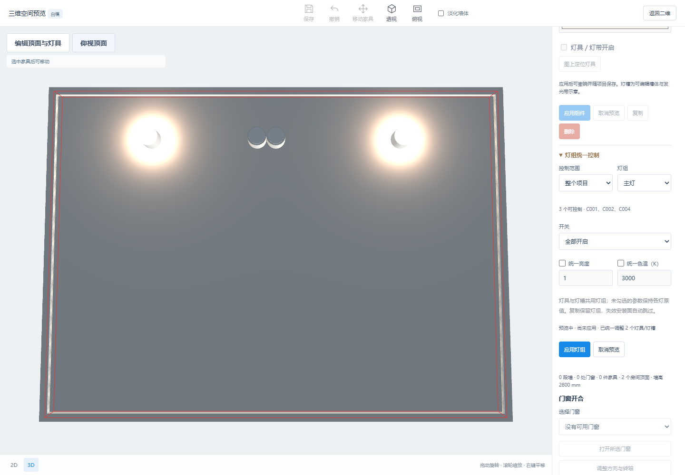
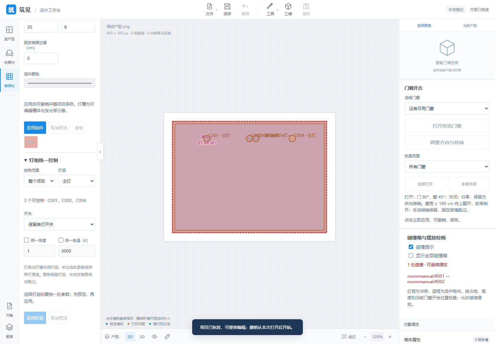
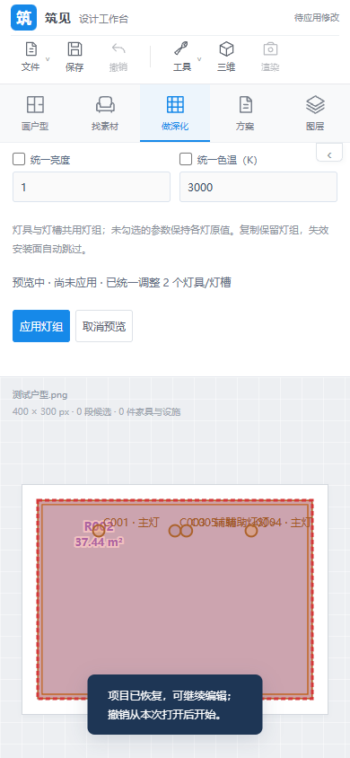

# P35 灯具与灯槽分组控制

2026-10-14 已接入 **做深化 → 天花板 · 吊顶 · 灯具**，三维通过“编辑顶面与灯具”使用同一编辑器。

1. 选中灯具或灯槽，填写灯组名称并应用；留空表示未分组，复制保留组名。
2. 展开“灯组统一控制”，选择当前房间或整个项目，再选命名组、未分组或所有灯具与灯槽。
3. 开关可保留各灯原值、全部开启或全部关闭。勾选统一亮度/色温才修改对应参数。
4. 参数更改后二维/三维预览，点击应用整组提交；取消或 Esc 恢复。整组操作只增加一次撤销记录，状态没有变化时不增加历史或未保存状态。

组名最多 40 字，按完整名称匹配，首尾空格去除；同名组可跨房间，成员关系随项目保存。改名通过逐件修改组名完成；不包含整组搬动或自动排灯。缺失房间或安装面的组件保留原数据并跳过，界面反馈数量；恢复安装面后重新参与控制。旧项目不自动分组。逐件修改仍可覆盖自己的开关、亮度和色温。

灯组只改照明参数，保留位置、尺寸、安装面及颜色。照明仍采用现有预览：最多 16 个有效灯具实时光源，灯槽为发光带示意，真实间接反射、商品模型和独立轨道系统待做。

## 验证

Python 顶面、灯组、房间编辑、保存及页面接口专项 47 项通过，覆盖房间/全项目范围、灯槽与灯具混合、未分组、部分参数、非法输入与原子提交、失效安装面跳过、旧项目、复制保留组名，以及接口请求保护、预览、无变化、一次撤销、保存重开。Node 116 项回归通过。

实际浏览器核查覆盖桌面、390 px 窄屏、二维/三维预览取消、共享编辑保护、灯槽开关、部分参数、复制、名称显示、重复操作不增加历史/未保存状态、整组撤销及保存重开。原有吊顶首版浏览器回归通过。

```powershell
.\.venv\Scripts\python.exe -m unittest test_lighting_groups test_ceilings test_web test_room_editing test_projects
node --test test_*.mjs
# 在 NODE_PATH 提供 Playwright 后运行：
node tools/check_lighting_groups_ui.cjs
node tools/check_ceilings_ui.cjs
```






