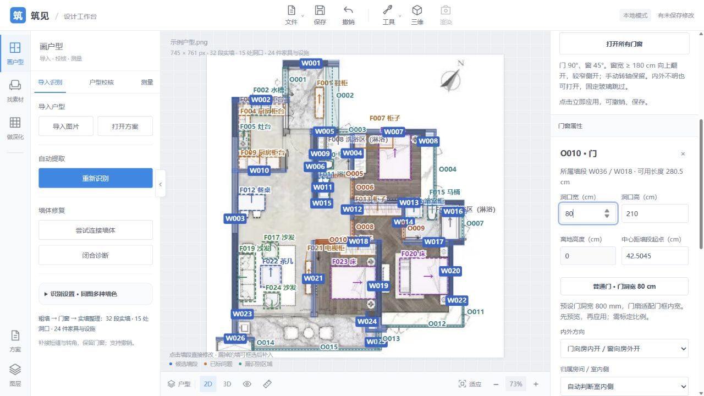

# 普通门 80 cm 预设 · 2026-10-12

用户明确选择门洞宽 800 mm，门扇适配门框内宽。门属性按钮预览 80 cm，再应用。全局门洞默认预设改为 800 mm，既有保存设置保留；默认按图换算模式不会自动改写已有洞口。

- 32 项相关 Python 检查：横/竖墙的门洞宽、角度/转轴/门高保留、窗不可用、未标定拒绝、API 保存重开及一次撤销，原门窗预设和编辑回归。
- 61 项 Node 检查：80 cm 洞口与适配门扇的二维/三维一致；当前示意门框两侧各 40 mm、缝隙各 3 mm，门扇为 714 mm；旧全局 900 mm 保存值保留。原几何回归通过。
- 浏览器：在独立页面打开已标定方案 20261010-220648-7b981a，O010 从 85.009 cm 点预设变为 80 cm，显示有效预览，应用成功，再打开三维同步。测试未写回原保存方案。
- 原 8768 页面恢复当前已保存方案并选中 O010，按钮可见；当前未标定，按钮按规则禁用，需标定后使用。

