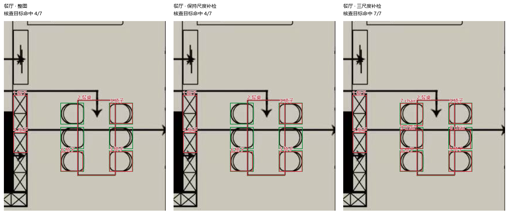
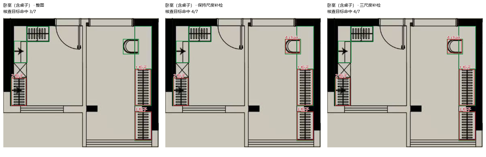
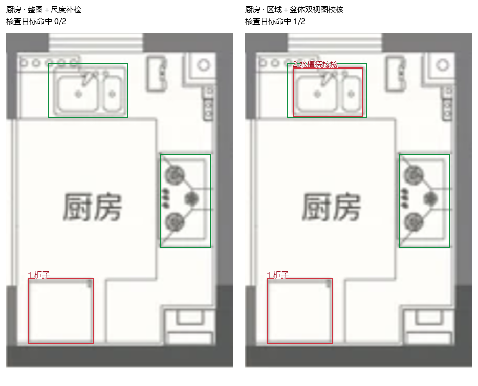

# 分区家具识别可行性验证

结论：值得继续做小范围原型。当前证据支持“整图保底 + 控制尺度的分区补检 + 房间用途与物体形状联合校核”。直接裁出房间并放大送入现有模型，结果明显下降；仅给优先类别降低分数门槛也没有增加命中。

本轮仅运行离线实验脚本，没有修改页面、正式识别代码、模型、参考模板，也没有提交或推送这些实验文件。

## 样本与判定方法

- 两张已有图片：灰底家具图 `input/furniture-references/06.jpg`，白底线稿 `input/reference-plans/04-furnished.png`。
- 手工划定七个区域：灰底图的厨房、餐厅、左下柜桌区域；线稿图的厨房、餐厅、主卧、书房。灰底图左下区域按卧室清单测试，但原图没有房间名称，此处没有验证它的实际用途。
- 推理前固定 33 个可见物体核查框，包含床、柜体、桌子、椅子、水槽、灶台和冰箱。坐标在 `cases.json`。这是选定目标集合，不是完整家具清单。
- 同类别物体框与人工框交并比 IoU ≥ 0.5 算命中，一对一匹配。通用桌子与餐桌归为桌类，通用柜体与厨房柜台归为柜类；这只验证大类和位置，不代表具体用途已正确识别。
- 灰底图已用于现有模板校准；线稿图未加入家具模板库，但此前也已用于模型开发核查。两张图都不是独立盲测集，不能从这次数字推算通用准确率。

## 结果

| 方法 | 核查目标命中 | 观察 |
|---|---:|---|
| 现有整图识别 | 22 / 33 | 对照基线 |
| 直接裁出区域、单独识别 | 7 / 33 | 原有模型候选大量丢失 |
| 整图加直接裁剪补检 | 22 / 33 | 没有补回目标 |
| 整图优先类别降低门槛至 0.40 | 22 / 33 | 分数门槛变化未带来命中收益 |
| 整图加受控尺度区域补检 | 26 / 33 | 补回三把餐椅和一把书桌椅 |
| 再加厨房盆体联合校核 | 27 / 33 | 再补回线稿厨房的一个水槽 |

“受控尺度”实验在区域周围补与原图背景一致的空白，分别以整图推理中的物体尺度的 1、1.5、2 倍运行模型，再与整图结果去重合并。七个区域全部使用相同三个倍率，没有按目标挑选不同参数。模板仍保留整图识别结果。分别仅使用单一倍率时，命中为 23、24、26；三个倍率合并仍为 26。

“厨房盆体联合校核”是观察失败后提出的探索性规则：候选必须位于手工厨房区域，原始模型类别为 bath 且分数 ≥ 0.75，另一种图像处理也以 bath 检出（分数 ≥ 0.7、两框 IoU > 0.65），且内部存在面积占比 0.2–0.65、近似多边形顶点数 5–12 的封闭轮廓。形状与双视图门槛复用现有卫浴校核思路，没有全局改写 bath 类别。输出只是待校核水槽候选。

| 区域 | 核查数 | 整图 | 直接裁剪 | 尺度补检后 | 再加厨房校核 |
|---|---:|---:|---:|---:|---:|
| 灰底图厨房 | 6 | 6 | 5 | 6 | 6 |
| 灰底图餐厅 | 7 | 4 | 1 | 7 | 7 |
| 灰底图左下柜桌区域 | 7 | 3 | 1 | 4 | 4 |
| 线稿图厨房 | 2 | 0 | 0 | 0 | 1 |
| 线稿图餐厅 | 5 | 3 | 0 | 3 | 3 |
| 线稿图主卧 | 4 | 4 | 0 | 4 | 4 |
| 线稿图书房 | 2 | 2 | 0 | 2 | 2 |

## 看得见的变化

绿色框为人工核查目标，红色框为输出候选。

餐厅原来只有三把椅子被识别；控制倍率后补回其余三把。桌面原本就已识别。



卧室清单包含桌子。此处只补回右侧书桌椅；右侧书桌、左侧梳妆桌和左上柜体依然漏检。不能把椅子命中说成桌子已识别。



厨房联合校核补回水槽，灶台依然漏检。



## 误检与用途预设的作用

- 对新增的四把椅子和一个水槽逐框目视检查，均对应原图中实际物体；这些实验最终没有增加其他合并候选。但只核查两张图，不能据此宣称零误检。
- 原有错类或歧义没有全部消除，例如线稿厨房左下矩形仍作为通用柜体输出，其是否为冰箱无法仅凭这一标记确定。
- 对尺度补检做了“使用房间类别清单 / 不使用清单”的对照，两者候选完全相同，均命中 26/33。因而不能把四把椅子的收益归因于房间用途优先级；证据指向裁剪范围与物体尺度处理。
- 房间用途实际发挥作用的是厨房水槽的联合校核：同样的盆形符号出现在不同房间，用途可能不同。厨房范围提供一项依据，形状和双视图再提供其他依据。该探索性规则仍需陌生户型和负样本验证。
- 原始类别有明显歧义：连续反色视图把灰底图的冰箱和灶台都标为 sink，把线稿图灶台也标为 sink。直接用“厨房里出现 sink 就当水槽”的规则会出错。

## 耗时与下一步

本次整图家具检测分别为 17.26 秒和 16.97 秒。受控尺度补检总共七个区域、21 次模型调用，共计约 3.08 秒，其中灰底图 1.39 秒、线稿图 1.70 秒。这是一次本机运行的模型调用计时，不含自动分区、页面渲染及完整耗时基准测试。

下一步优先做“手工框区域并确认用途”的小原型，保留整图结果，区域补检只提供新增或待复核候选；卧室清单明确包含桌子。先在更多未用于模板或规则调整的图片上验证，再决定是否开发自动区域边界和用途识别。

本次区域由人提供，没有测自动房间划分、自动房间命名、区域边界误差或错误用途标签的影响。自动分区难度仍需另做实验，不能把家具命中提升当成自动分区已经可用。

## 复现与原始记录

在 `wall-recognition` 目录，用现有虚拟环境按顺序运行：

```powershell
.\.venv\Scripts\python.exe output/region-feasibility-v1/evaluate.py
.\.venv\Scripts\python.exe output/region-feasibility-v1/check_scale.py
.\.venv\Scripts\python.exe output/region-feasibility-v1/check_semantics.py
```

`results.json` 为直接裁剪对照，`scale-results.json` 为三个固定倍率及降阈值对照，`semantic-results.json` 为厨房联合校核的保留与排除证据。`priority-audit.json` 记录尺度补检有无房间类别清单的对照。
