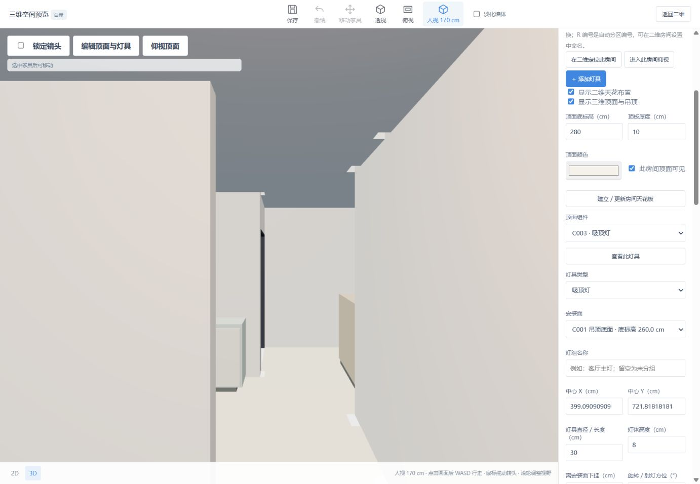

# 稳定人视与位置限制

2026-10-14：默认眼高 170 cm；WASD 控制站位，鼠标拖动只转头，限制俯仰并保持竖直方向。行走不能到地板下面、走出底板或穿过阻挡构件。

## 操作

- 首次打开三维进入人视；顶部“人视 170 cm”在当前房间寻找可站立位置。
- 点击画面后 W/S 前后、A/D 左右移动；方向跟随水平朝向，Shift 加速。
- 左键拖动转头，俯仰限制 ±85°；滚轮调整视野，不改变站位或高度。
- “锁定镜头”冻结鼠标、滚轮与行走输入。关闭三维、失焦、进入表单、松开按键均停止行走。
- 同项目关闭再打开三维保留镜头。切换房间或灯具设置不自动移动镜头，显式点击“查看此灯具”或“进入此房间仰视”才定位。
- “透视”和“俯视”查看整户；点击“人视 170 cm”重新启用行走。

## 空间约束

人体占地半径 18 cm，头顶按 185 cm 校核，眼高固定 170 cm。地面使用已有整图矩形底板范围，保留身体与边界距离。墙体沿用洞口感知几何；门窗按当前开合姿态参与，家具使用旋转占地箱，低顶面与低灯具阻挡，正常头顶上方构件不阻挡。顶面三角形保留孔洞。移动分成不超过 4 cm 的小步，避免高速穿过薄墙；受阻时尝试沿墙滑动。

人视/灯具定位寻找当前房间附近的有效站位，无有效位置时提示。首版支持平层；不包含台阶、楼梯、细部家具空腔或建筑规范判断。相机仅在当前页面会话中保留，不写入项目文件。

## 修复原因与验证

原先相机绕目标旋转，仰视灯具时又改变 up 方向，和轨道控制器缓存的方向不一致；重新打开三维还会无条件复位。现在使用独立水平朝向/俯仰控制器，输入只改变眼点方向或水平站位，显式定位始终采用世界 Y 向上。

- 全量 Node 测试：128/128 通过；新增相机 5 项、行走空间 5 项。覆盖极端拖动不翻转、鼠标不移动眼点、WASD 方向及斜向速度、松键/失焦/关闭停止、镜头锁定、薄墙防穿越、沿墙滑动、门洞/门扇/窗台、低顶面、孔洞和有效出生位置。
- Python HTTP 测试：1/1 通过，验证两个新模块由实际服务器以 JavaScript 类型返回，避免静态路由遗漏导致三维加载失败。
- 当前保存户型浏览器核对：人视入口与底部提示、鼠标转头、WASD 行走、低头靠墙受阻、灯具仰视、镜头锁定、同会话关闭再打开保留镜头。原方案构件数据不因相机操作改变。

