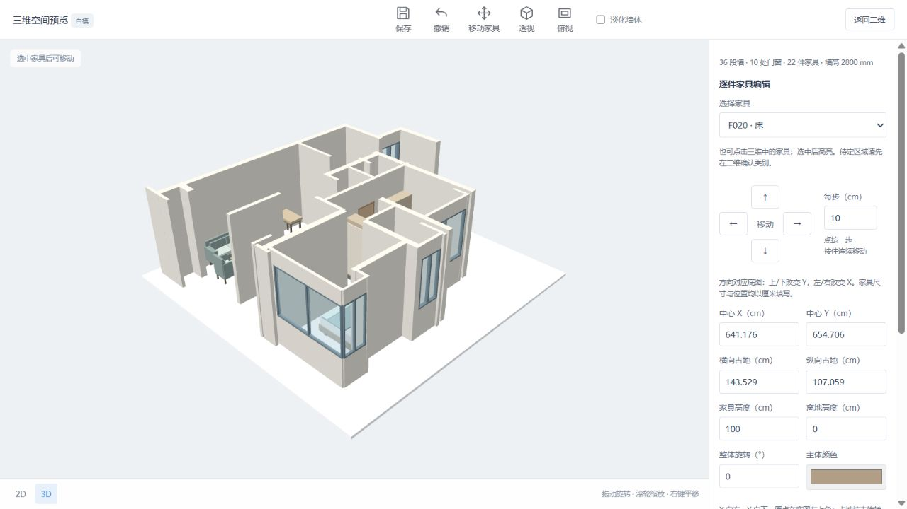
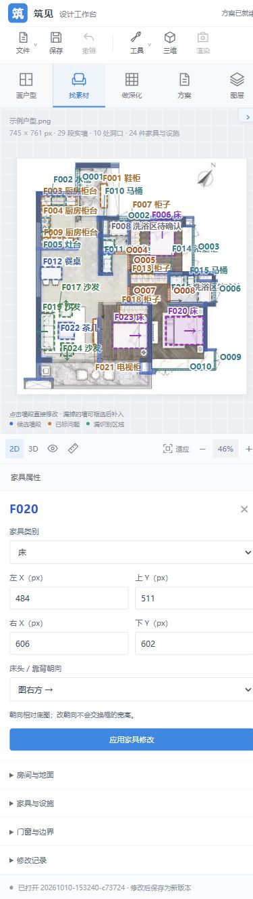

# 设计工具栏改版核查

日期：2026-10-10。

参考酷家乐官方 [了解工具界面](https://www.kujiale.com/hc/article/3FO4K4VVGD1O) 及其中完整界面图（文档更新时间 2025-11-04）。复用布局和操作位置，使用筑见品牌及本项目图标、功能与模型。

## 已接入

顶部文件、保存、撤销、工具菜单与三维入口；左侧画户型/找素材/做深化、方案/图层导航；独立滚动与收起面板；网格画布与底部 2D/3D、图层、测量、适应、缩放；右侧墙体、家具、房间属性及折叠目录。三维改为全屏，顶部常用命令与底部返回二维。

家具面板提供 17 类本地程序化家具类别搜索。选择类别后框选占地，自动填入右侧类别，再应用；仍可自定义框选和更改类别。快捷键 Ctrl/⌘+S 保存、Ctrl/⌘+Z 撤销，输入框内保留原生文本撤销。

## 验证

- 使用独立测试服务器 `127.0.0.1:8772`，反馈和项目位于本目录忽略的 `testdata/`，与用户项目隔离。
- 浏览器实际验证示例识别、顶部打开方案菜单、恢复已保存户型、墙厚标定和底部进入三维；未识别时不可用命令及其多个入口均禁用。
- 搜索“床”仅显示床类别，搜索无匹配词显示空结果；选床后实际拖框，右侧类别为床；修改 X 后切换导航，输入保留；应用新增家具后 Ctrl+Z 撤销，Ctrl+S 保存，刷新后从顶部文件菜单恢复。
- 收起工具面板时画布宽度从 708 px 增至 944 px，再选流程导航恢复面板；左右箭头可切换户型页签，房间目录能展开及再次收起。
- 390 px 窄屏导航改为横排，工具面板可收起，属性位于画布下方；检查文档可视宽与滚动宽一致，无横向溢出。
- 801 px 桌面布局临界宽度：页面无横向溢出，画布底部所有可见按钮均位于画布边界内。
- `node --test test_furniture_move.mjs test_furniture_models.mjs test_model_geometry.mjs`：17 项通过。
- `check_furniture_nudge_ui.cjs`：即时预览、单步/长按、每次操作单次提交、取消、键盘、自定义步长、cm 换算、撤销、外观保留和保存重开通过；390 px 三维无横向溢出，无页面错误。
- `check_furniture_move_ui.cjs`：实际拖拽、取消、单次提交、无移动不提交、旋转占地边界、撤销、失败恢复、保存重开通过；窄屏无横向溢出，无页面错误。
- JavaScript 语法及 `git diff --check` 通过。

## 范围

公开新版布局参考，尚非像素级完整复刻。素材卡是本地类别入口，不是酷家乐商品资源；框选仍需应用，没有新实现画墙、门窗拖放、多层、云素材、AI、渲染、出图、重做或协作。渲染按钮明确禁用，右侧提供三维入口而非实时迷你三维视图。二维识别框坐标仍为 px；已标定三维家具输入继续使用 cm。

