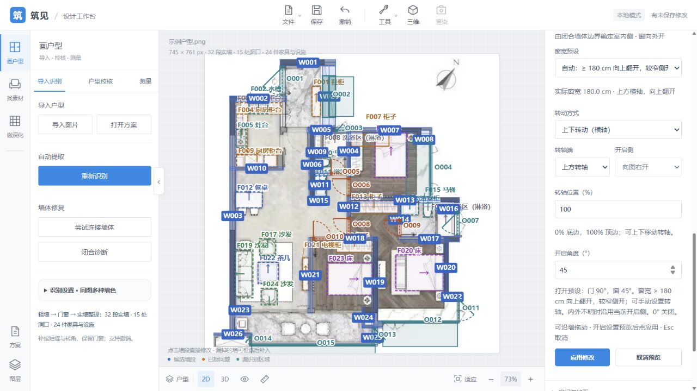
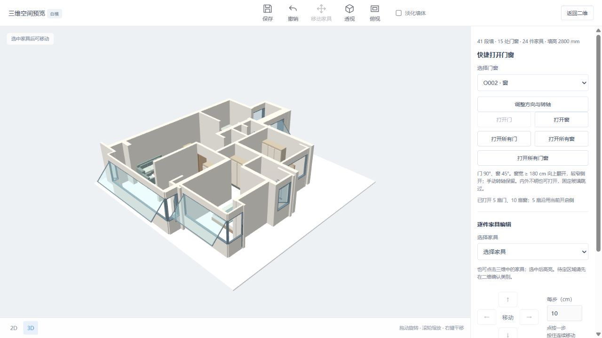

# 窗宽预设核查 · 2026-10-12

默认阈值 1800 mm，包含等于：上方横轴，顶边轴位 100%，底边抬起。较窄采用侧面竖轴起端 0%；快捷打开 45°。支持手动覆盖，固定玻璃跳过。未标定且没有实际宽度暂用侧开，标定后同步预设。

- 30 项 Python：临界值、横/竖墙、宽度来源、尺寸修改、重新标定、手动覆盖、固定窗、校验、保存重开、一次撤销及原开启/编辑回归。
- 60 项 Node：加入宽度来源、边界值、双侧双墙向顶轴不动/底边抬升、二维投影与三维四元数、尺寸预览、手动覆盖与固定窗；原几何回归通过。
- 实际浏览器：独立打开已标定方案 20261010-220648-7b981a，一键打开 5 门、10 窗，方向不明也打开。O002 原宽 263.5 cm 自动上翻；输入 179.9 cm 即侧开，180 cm 即上翻，应用成功并打开三维，无控制台错误。测试方案未写回原保存文件。
- 用户当前方案已保存后在原 8768 地址恢复，所有门窗可打开，O005/O008/O010 均为 90°。当前未标定，窗先侧开；O012 属性显示自动宽度预设及标定提示。

